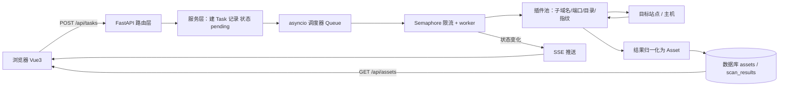

# 技术栈与知识点地图

> 这份文档是给自己用的**检查表**，不是交给学校的材料。
>
> **用法**：每一项后面的「自测」你能自己答上来，这一项就算过了，不用继续往下深挖。答不上来再回去查。
>
> **标记**：🔴 必须能自己写出来（绕不开，答辩也常问）｜🟡 能看懂、能改，出问题会修｜⚪ 知道它存在，用到再查

---

## 0. 全景：一次扫描任务是怎么跑完的

先看这条线。**所有知识点都挂在这条线上**，脱离它去背概念，学完就忘。

逐步说明：

1. **用户在前端点「新建扫描」** → axios 发 `POST /api/projects/{id}/tasks`，请求头带 `Authorization: Bearer <token>`
2. **路由层**用 `Depends` 取出当前用户和数据库会话，校验这个项目归不归他
3. **服务层**建一条 `Task` 记录（状态 `pending`），**立刻返回 task_id**——注意这里不能阻塞，扫描可能要跑几分钟
4. **调度器**从 `asyncio.Queue` 里取任务，`Semaphore` 控制同时跑几个
5. **插件**各自干活，都实现同一个接口 `run(target) -> list[Asset]`
6. **结果归一**：每个插件返回的格式不同，统一成 `Asset`
7. **落库**：写进 `assets` 和 `scan_results`
8. **SSE** 把状态（pending → running → 40% → done）推回前端，进度条动起来

---

## 1. Python 地基

| 知识点 | 在这个项目里用在哪 | 标记 |
| --- | --- | --- |
| 类型注解 `def f(x: str) -> int` | FastAPI 的地基。`name: str` 看不懂，后面寸步难行 | 🔴 |
| `list[str]` / `Optional[X]` / `dict[str, int]` | Pydantic 模型的字段类型 | 🔴 |
| 装饰器 `@app.get("/")` | 理解「为什么函数上面加个 @ 就变成接口」 | 🔴 |
| 类与 `self` | SQLAlchemy 模型、Pydantic 模型、插件类全是类 | 🔴 |
| 字典 / 列表 / 集合 / 推导式 | 结果归一去重（子域名去重必用 `set`） | 🔴 |
| 异常 `try / except / raise` | 一个插件崩了不能拖垮整个任务 | 🔴 |
| 模块与包 `import` | `app/` 目录靠它组织，循环导入是常见坑 | 🔴 |
| `async def` / `await` | 调度器和插件全是异步的 | 🔴 先会读，后会写 |
| 生成器 `yield` | `Depends(get_db)` 内部就是 yield，写数据库依赖会用到 | 🟡 |
| `with` 上下文管理器 | 文件读写、数据库会话管理 | 🟡 |

**自测**：`@app.get("/")` 加在一个普通函数上，为什么它就变成一个 HTTP 接口了？

---

## 2. FastAPI：接口层

| 知识点 | 在这个项目里用在哪 | 标记 |
| --- | --- | --- |
| `FastAPI()` 实例 + `uvicorn` 启动 | `main.py` | 🔴 |
| 路径参数 / 查询参数 / 请求体 | `/api/projects/{id}`、`?page=1&size=20`、POST body | 🔴 |
| `APIRouter` 与目录分层 | `app/api/v1/projects.py`，拆开才好维护 | 🔴 |
| Pydantic `BaseModel` / `Field` 校验 | `ProjectCreate`、`AssetOut`，`name: str = Field(min_length=2)` | 🔴 |
| `response_model` + `from_attributes` | 从 ORM 对象转 JSON，且**绝不能把 password_hash 返回出去** | 🔴 |
| `Depends` 依赖注入 | 取数据库会话 `get_db`、取当前用户 `get_current_user` | 🔴 |
| `HTTPException` 与状态码 | 400 参数错 / 401 未登录 / 403 无权限 / 404 不存在 | 🔴 |
| 中间件与 CORS | 前端 5173 访问后端 8000，不配这个浏览器直接拒绝 | 🔴 |
| `/docs` 自动文档与 422 报错 | 422 是 Pydantic 校验失败，**不是 bug** | 🔴 |
| `lifespan` 启动钩子 | 启动时初始化数据库、启动调度器 | 🟡 |
| `StreamingResponse` | SSE 推送扫描进度 | 🟡 |

**自测**：POST 一个 `name` 只有一个字符的项目，返回什么状态码？那条中文错误信息是谁生成的、在哪改？

---

## 3. 数据库与 ORM：数据层

| 知识点 | 在这个项目里用在哪 | 标记 |
| --- | --- | --- |
| 表 / 主键 / 外键 / 索引 | 5 张表的关系设计 | 🔴 |
| 一对多 / 多对多 | User→Project→Task→ScanResult；Asset 与 Project | 🔴 |
| 基础 SQL 四句 | 会读就行，写交给 ORM | 🟡 |
| SQLAlchemy 2.0 模型写法 | `Mapped[str]` / `mapped_column()`，`app/models/user.py` | 🔴 |
| `relationship()` | Task 能直接 `.project` 拿到所属项目 | 🔴 |
| Session 生命周期 | 一个请求一个 Session，**绝不能跨请求复用** | 🔴 |
| Alembic 迁移三连 | 改模型 → `alembic revision --autogenerate` → 人工检查 → `upgrade head` | 🔴 |
| 事务与回滚 | 批量写资产时，一个失败不能留半截脏数据 | 🟡 |
| N+1 查询与 `selectinload` | 资产列表每行都单独查一次项目名 → 页面卡 | 🟡 |
| SQLite vs PostgreSQL 差异 | 并发写、JSON 字段；开发期 SQLite 够用 | ⚪ |

**自测**：给 `Asset` 加一个 `icp_license` 字段，从改代码到数据库真的多出这一列，要执行哪几步？

---

## 4. 认证：JWT

| 知识点 | 在这个项目里用在哪 | 标记 |
| --- | --- | --- |
| 密码哈希（bcrypt + 盐） | `passlib` 的 `CryptContext`，注册和登录 | 🔴 |
| 为什么绝不能存明文密码 | 答辩必问，也是常识底线 | 🔴 |
| JWT 三段结构 | header.payload.signature；前端可解析 exp 判断过期 | 🟡 |
| `OAuth2PasswordBearer` | FastAPI 内置的 token 提取方式 | 🔴 |
| 登录接口 `/api/auth/login` | 表单传 `username`/`password`，返回 `access_token` | 🔴 |
| token 存哪里 | localStorage（简单，怕 XSS）vs HttpOnly Cookie（安全，麻烦） | 🟡 |
| 用依赖注入做权限 | `get_current_user`、`require_admin` | 🔴 |
| CORS 与 CSRF 的区别 | 前后端分离最容易混的两个概念 | 🟡 |

**自测**：登录一次之后，下一个请求凭什么证明「我就是我」？服务端有没有存 session？

---

## 5. 异步与调度器：项目的心脏（最关键的一层）

| 知识点 | 在这个项目里用在哪 | 标记 |
| --- | --- | --- |
| 同步 / 异步 / 多线程的区别 | 为什么扫描必须异步：等待 IO 的时间要用来发别的请求 | 🔴 |
| 事件循环 / 协程 / `await` | 整个调度器建立在这上面 | 🔴 |
| `asyncio.create_task` | 后台跑任务，接口立刻返回 | 🔴 |
| `asyncio.Queue` | 任务队列 | 🔴 |
| `asyncio.Semaphore` | 并发限流，同时最多 N 个请求 | 🔴 |
| `asyncio.gather` | 一个任务内多个插件并行跑 | 🔴 |
| 超时 `asyncio.wait_for` | 单个子域名查询不能无限等 | 🔴 |
| 取消 `task.cancel()` + `CancelledError` | 用户点「停止扫描」 | 🟡 |
| 任务状态机 | pending / running / success / failed / cancelled | 🔴 |
| 断点续扫 | 中途挂掉，重启从上次位置继续（加分项） | ⚪ |
| 阻塞代码要丢线程池 | `async def` 里写了 `time.sleep` 会卡死整个服务 | 🟡 |
| SSE | `StreamingResponse` + `text/event-stream` | 🟡 |

**自测**：同时提交 100 个扫描任务，怎么保证不会把目标站点打挂、也不会把你自己服务器拖死？

---

## 6. 插件化扫描引擎：项目的骨架

| 知识点 | 在这个项目里用在哪 | 标记 |
| --- | --- | --- |
| 统一接口 `run(target) -> list[Asset]` | 所有插件都必须实现它 | 🔴 |
| 插件注册机制（装饰器或字典登记） | 新插件放进去，调度器自动发现 | 🔴 |
| 输入模型 `Target` | 域名 / IP / C 段 | 🔴 |
| 输出模型 `Asset` | 资产类型、值、来源插件、发现时间 | 🔴 |
| 结果去重与合并 | 多个插件都会发现同一个子域名 | 🟡 |
| 错误隔离 | 一个插件异常不能影响其他插件和整个任务 | 🔴 |

**自测**：新写一个「查 ICP 备案」的插件，需要改哪几个文件？——理想答案是**只新增一个文件**，这才叫插件化。

---

## 7. 扫描能力本身：你的舒适区

| 知识点 | 在这个项目里用在哪 | 标记 |
| --- | --- | --- |
| socket TCP 连接 | 端口探测的原理 | 🔴 |
| DNS 记录类型 A/AAAA/CNAME/MX/NS/TXT | 子域名枚举、资产发现 | 🔴 |
| 泛解析判断 | 不做这一步，字典爆破会得到一堆假子域名 | 🔴 |
| httpx 异步客户端 | 目录扫描、指纹识别都靠它 | 🟡 |
| dnspython 异步查询 | `dns.asyncresolver` | 🟡 |
| 指纹识别 | 响应头 / body 特征匹配 | 🟡 |
| 目录字典与状态码含义 | 200 / 301 / 403 意思完全不同，不能一律当「存在」 | 🟡 |
| JS 里提取接口路径 | 正则够用，AST 是加分项 | ⚪ |
| 把命令行工具改造成函数 | 把 subfinder / nmap 包成异步可调度的插件 | 🟡 |

---

## 8. Vue 3：前端

| 知识点 | 在这个项目里用在哪 | 标记 |
| --- | --- | --- |
| 单文件组件 `.vue` | 每个页面都是组件 | 🔴 |
| 模板语法 `v-if` / `v-for` / `v-model` | 列表渲染、表单绑定 | 🔴 |
| `ref` / `reactive` / `computed` | 数据变了页面自动跟着变 | 🔴 |
| `onMounted` | 进页面就去拉列表 | 🔴 |
| Vue Router + 路由守卫 | 没登录直接跳登录页 | 🔴 |
| Pinia | 全局存 token 和当前用户信息 | 🟡 |
| axios 拦截器 | 请求自动带 token；收到 401 自动踢回登录页 | 🔴 |
| Element Plus 表格 / 分页 / 弹窗 | 资产列表页基本全靠它 | 🟡 |
| Vite 代理 `/api` → 8000 | 开发期解决跨域 | 🔴 |
| ECharts | 资产类型分布饼图 | ⚪ |

---

## 9. 工程化与部署

| 知识点 | 在这个项目里用在哪 | 标记 |
| --- | --- | --- |
| Git 提交与分支 | 已经在用了 | 🔴 |
| logging 日志 | 扫描任务没有日志等于瞎，出问题无从查 | 🟡 |
| pydantic-settings + `.env` | 数据库密码、JWT 密钥不能进代码库 | 🔴 |
| pytest | 至少给插件写单测 | 🟡 |
| Docker / docker-compose | 最后一步，一键部署 | ⚪ |
| nginx 反向代理 | 生产环境才需要 | ⚪ |

---

## 10. 学习顺序（按依赖关系，不是按目录顺序）

| 阶段 | 学什么 | 结束时手里有什么 |
| --- | --- | --- |
| 一 | Python 类型注解 + 装饰器 → FastAPI 路由 / Pydantic / Depends | `main.py` 拆成 `app/` 四层，能跑 |
| 二 | SQLAlchemy 模型 + Alembic 迁移 | 一个完整 CRUD，数据真落盘 |
| 三 | JWT 登录闭环 | 能拿账号密码登录拿到 token |
| 四 | asyncio 三个原语（Queue / Semaphore / gather） | 一个最小调度器，先不接真扫描 |
| 五 | 插件接口 | **两个假插件**（睡 1 秒返回假数据），全链路打通 |
| 六 | 换成真插件 | 真实扫描能力逐个接入 |
| 七 | Vue 前端 | 登录页 + 列表页 |
| 八 | 加分项 | SSE 进度、报告导出、AI 助手、Docker |

**阶段五的假插件极其重要。** 先用假数据把「提交任务 → 调度 → 结果入库 → 前端看到」这条线跑通，再接真扫描。否则你会在网络超时、代理、DNS 解析这些环境问题上卡到怀疑人生，而且分不清到底是架构写错了还是网络不通。

---

## 11. 术语速查

| 术语 | 一句话解释 |
| --- | --- |
| ORM | 用 Python 类操作数据库，不用手写 SQL |
| 数据库迁移 | 改完模型，把改动同步到真实数据库版本的过程 |
| 依赖注入 | 函数声明「我需要什么」，框架负责给，不用自己 new |
| 中间件 | 请求进到接口之前 / 返回之后都要经过的一层 |
| CORS | 浏览器跨域限制，前后端分离必须放行 |
| JWT | 一种自带签名的 token，服务端不用存 session |
| SSE | 服务器单向持续推送消息给浏览器，做进度条用 |
| 并发限流 | 同时只允许 N 个请求在跑，多的排队 |
| 幂等 | 同一个请求执行多次，结果和一次一样 |
| 状态机 | 用一组明确定义的状态和转移规则描述任务生命周期 |
| 插件化 | 功能像积木一样插进来，加功能不用改主程序 |
| 指纹识别 | 从响应特征判断目标用了什么框架 / 中间件 / CMS |
| 泛解析 | 域名配置成「任何子域名都解析」，会伪造出海量子域名 |
| C 段 | 同一网段内的 IP 范围，例如 1.2.3.0/24 |
| ICP 备案 | 网站的主体备案信息，可合法公开查询 |
